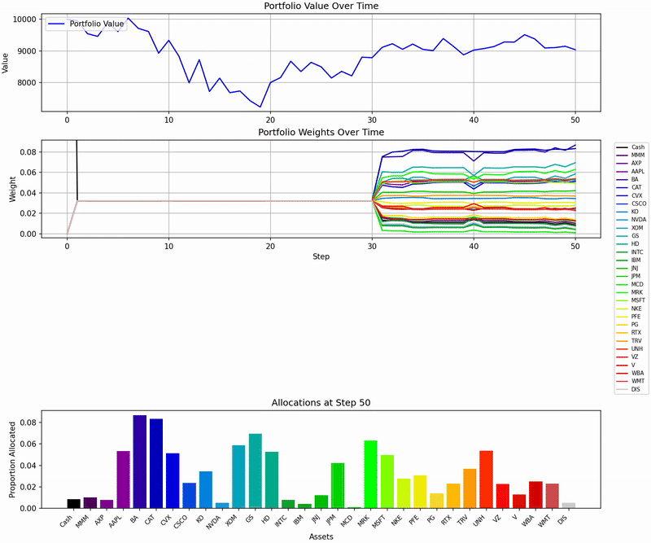

# Project Overview

Hello!

This is an extension of my undergraduate final-year project, which aimed at evaluating risk-sensitive reward functions (logarithmic returns, the differential sharpe ratio, and a CVaR-minimising function that I created) in a portfolio management framework. Originally the project applied a PPO-LSTM (proximal-policy-optimisation) architecture along with an LSTM (Long-Short-Term Memory) feature-extractor to a single portfolio consisting of 24 stocks, with six stocks each from the DOW, FTSE-100, SSE50 and SENSEX indices.

Major improvements I have made include:

- The addition of a CNN (Convolutional Neural Network) Feature extractor, as another option to the LSTM module.
- The addition of a recurrent TD3 (Twin-Delayed-Deep-Deterministic) algorithm, as another option to PPOLSTM.
- Be evaluated on three distinct portfolios of the DOW, FTSE-100, and SSE50.
- The ability to visually render the trading period.
  - hit `localhost:{port}/generateAnimation` when the container is running to do this. Find the relevant port for the specific index in `fullDockerPipeline.bat`. You can see the result if you check the dockerfiles at `src/main/animations/{index}/{agent}/{stage}/`, where `index` is dow, ftse100, or sse50, and `stage` is either hyperparameter-tuning or reward testing (depending on what you're running).
    An example of a generated animation (only 5 seconds):
    
- Dockerisation of the process, for portability.
- A REST server (implementing multithreading), to check the status of the docker containers and generate animations on demand.
  - The health endpoint is at `localhost:{port}/health`.
- Include unit and integration testing.

Other, more minor improvements can be found commented in the code.

For a more in-depth explanation of the reinforcement learning theory, network architectures, architecture diagram etc, you can have a look at [Project Explanation](ProjectExplanation.pdf).

To run the project (on windows), simply clone the repo and run:
`fulldockerPipeline.bat [{index-name (sse50, dow, ftse100)}]`

For example:
`fullDockerPipeline.bat sse50` would work in your .cmd.exe.
A word of caution - reinforcement learning experiments are quite memory and compute intensive. Depending on your setup, hyperparameter tuning along with reward testing can take days or even a couple of weeks to run through fully.

You might want to ensure you have a stable internet connection when running the containers, for wandb logging (log into your wandb account) to see gradients/parameters etc. for each run and to spin up the RestServer.

## Transparency Statement

The conceptual work, algorithm design and methodology of this project are my own. This includes the problem formulation, the reward functions (including the CVaR-informed reward), the PPO/TD3 and feature-extractor architectures and implementation, and the experimental design. Some smaller helper functions are marked as "AI supported" in code comments.

The final stage of the project was carried out with Claude (Anthropic's AI assistant, via Claude Code):

- **Final bug fixes to the reward-testing pipeline.** Including: fixing a reward output bug, learning-curve file handling, stop-loss trajectory handling, the random-baseline seeding, the data-download caching and retries, replacing delisted tickers, Docker config handling, and a quick-test mode.
- **Results analysis and write-up.** This covers the analysis of the final experiment outputs and the Results section, abstract refinement and conclusion of the [Project Explanation](ProjectExplanation.pdf), including its results tables and figures. Claude also corrected factual details in the methodology section where they no longer matched the code (for example, the data period, the TD3 parameters and the sliding-window formulae).

The experiments themselves were run on my own machine.

Thanks for stopping by :)
